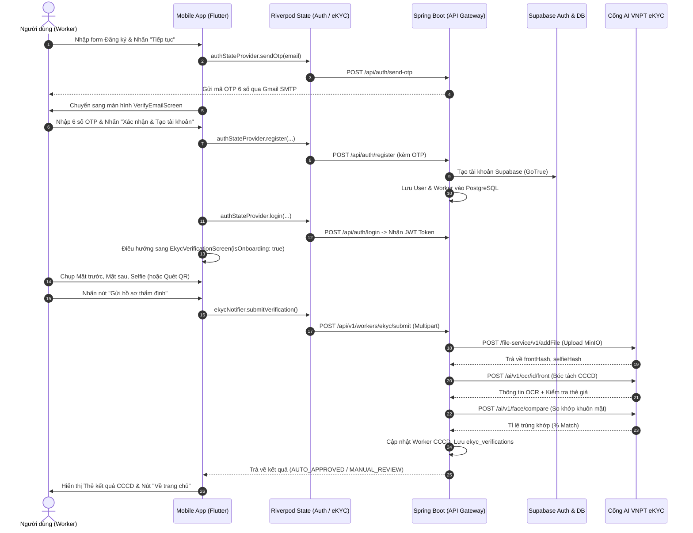

# TÀI LIỆU CHI TIẾT LUỒNG NGHIỆP VỤ: TỪ ĐĂNG KÝ TÀI KHOẢN ĐẾN ĐỊNH DANH ĐIỆN TỬ (eKYC)
**Dự án:** CANi - Nền tảng Điều phối Nhân sự Sự kiện  
**Phạm vi:** Ứng dụng Di động Worker (Flutter) & Máy chủ Backend (Spring Boot, Supabase, VNPT eKYC)  
**Thời gian cập nhật:** Tháng 10/2026  

---

## 📌 MỤC LỤC
1. [Sơ đồ tuần tự tổng quan (Sequence Diagram)](#1-sơ-đồ-tuần-tự-tổng-quan-sequence-diagram)
2. [Giai đoạn 1: Khởi động Đăng ký (RegisterScreen)](#2-giai-đoạn-1-khởi-động-đăng-ký-registerscreen)
3. [Giai đoạn 2: Xác thực mã OTP qua Email (VerifyEmailScreen)](#3-giai-đoạn-2-xác-thực-mã-otp-qua-email-verifyemailscreen)
4. [Giai đoạn 3: Luồng thay thế - Đăng ký nhanh qua Google](#4-giai-đoạn-3-luồng-thay-thế---đăng-ký-nhanh-qua-google)
5. [Giai đoạn 4: Thu thập hồ sơ CCCD & Quét QR (EkycVerificationScreen)](#5-giai-đoạn-4-thu-thập-hồ-sơ-cccd--quét-qr-ekycverificationscreen)
6. [Giai đoạn 5: Nộp hồ sơ & Thẩm định AI VNPT tại Backend](#6-giai-đoạn-5-nộp-hồ-sơ--thẩm-định-ai-vnpt-tại-backend)
7. [Giai đoạn 6: Nhận kết quả & Điều hướng vào Trang chủ](#7-giai-đoạn-6-nhận-kết-quả--điều-hướng-vào-trang-chủ)
8. [Bảng tra cứu nhanh "Nút nào - File nào - Hàm nào"](#8-bảng-tra-cứu-nhanh-nút-nào---file-nào---hàm-nào)

---

## 1. Sơ đồ tuần tự tổng quan (Sequence Diagram)



---

## 2. Giai đoạn 1: Khởi động Đăng ký (RegisterScreen)

### 2.1. Điểm xuất phát từ màn hình Đăng nhập (LoginScreen)
* **File:** `mobile/lib/features/auth/screens/login_screen.dart`
* **Nút bấm:** Liên kết dạng chữ `TextButton`: **"Chưa có tài khoản? Đăng ký ngay"** (dòng 282).
* **Hành vi:**
  ```dart
  Navigator.of(context).push(
    MaterialPageRoute(builder: (_) => const RegisterScreen()),
  );
  ```

### 2.2. Nhập thông tin tài khoản tại RegisterScreen
* **File:** `mobile/lib/features/auth/screens/register_screen.dart`
* **Người dùng nhập liệu:**
  1. Họ và tên (`_fullNameController`)
  2. Địa chỉ Email (`_emailController`)
  3. Số điện thoại (`_phoneController`)
  4. Mật khẩu (`_passwordController`) & Xác nhận mật khẩu (`_confirmPasswordController`)
  5. Tích chọn đồng ý Điều khoản dịch vụ (`_agreeTerms = true`)
* **Nút bấm:** Nút chính **"Tiếp tục"** (nút Gradient Ocean Cyan-Blue, dòng 363).
* **Hàm kích hoạt sự kiện (Event Handler):** `_proceedToVerifyEmail()` (dòng 69).
* **Logic thực thi:**
  1. Kiểm tra validation toàn bộ form: `_formKey.currentState?.validate()`.
  2. Kiểm tra điều khoản: bắt buộc `_agreeTerms == true`.
  3. Kích hoạt hàm gửi OTP trong Riverpod:
     ```dart
     final success = await ref.read(authStateProvider.notifier).sendOtp(email);
     ```

### 2.3. Tầng State & Tầng Mạng (Mobile)
* **Provider:** `mobile/lib/features/auth/providers/auth_provider.dart` -> hàm `sendOtp(String email)`.
* **Repository:** `mobile/lib/features/auth/data/auth_repository.dart` -> hàm `sendRegistrationOtp(email)`.
* **API Client:** `mobile/lib/features/auth/data/auth_api.dart` -> hàm `sendOtp(email, 'REGISTER')`.
* **HTTP Request gửi đi:**
  * **Method:** `POST`
  * **URL:** `/api/auth/send-otp`
  * **Body JSON:** `{"email": "worker@example.com", "otpType": "REGISTER"}`

### 2.4. Tầng Xử lý Backend (Spring Boot)
* **Controller:** `backend/src/main/java/com/cani/controller/AuthController.java`
  * Endpoint: `@PostMapping({"/send-otp", "/register/send-otp"})` (dòng 23)
  * Hàm: `sendOtp(@Valid @RequestBody SendOtpRequest request)`
* **Service:** `backend/src/main/java/com/cani/service/EmailOtpService.java`
  * Hàm: `sendOtp(String email, String otpType)`
  * Logic: Sinh ngẫu nhiên mã số 6 chữ số (`SecureRandom`), băm hoặc lưu tạm vào bảng `email_otp_verifications` kèm thời gian hết hạn (5 phút), gọi JavaMailSender gửi email HTML template qua Gmail SMTP của dự án CANi.

---

## 3. Giai đoạn 2: Xác thực mã OTP qua Email (VerifyEmailScreen)

### 3.1. Giao diện nhập mã OTP
* **File:** `mobile/lib/features/auth/screens/verify_email_screen.dart`
* **Giao diện:** 6 ô nhập mã pin tách rời (`OtpPinInputRow`), bộ đếm lùi 60 giây gửi lại OTP (`_startCountdown`).
* **Nút bấm:** Nút **"Xác nhận & Tạo tài khoản"** (dòng 225).
* **Hàm kích hoạt sự kiện:** `_submitVerification()` (dòng 91).

### 3.2. Tiến trình xử lý trong `_submitVerification()`
Hàm này thực hiện chuỗi 3 bước khép kín:

#### Bước A: Đăng ký tài khoản (Register)
* Gọi Riverpod:
  ```dart
  final registered = await ref.read(authStateProvider.notifier).register(
        email: widget.email,
        password: widget.password,
        fullName: widget.fullName,
        otpCode: otp,
        phone: widget.phone,
      );
  ```
* **HTTP Request:** `POST /api/auth/register`
* **Controller Backend:** `AuthController.java` -> hàm `register(RegisterRequest request)` (dòng 29).
* **Service Backend:** `backend/src/main/java/com/cani/service/AuthService.java` -> hàm `register(RegisterRequest request)` (dòng 110):
  1. Kiểm tra email chưa tồn tại trong bảng `users`: `userRepository.findByEmail(...)`.
  2. Kiểm tra mã OTP hợp lệ trong bảng `email_otp_verifications`: `emailOtpService.verifyOtp(...)`.
  3. Tạo tài khoản định danh trên Supabase GoTrue Auth: `supabaseAuthClient.signUp(email, password)`.
  4. Lưu thực thể `User` vào bảng `users` (PostgreSQL) với `role = Role.WORKER`.
  5. Khởi tạo thực thể `Worker` rỗng liên kết với `User` trong bảng `workers`.

#### Bước B: Tự động Đăng nhập lấy JWT Token (Auto Login)
* Gọi Riverpod:
  ```dart
  final loggedIn = await ref.read(authStateProvider.notifier).login(
        widget.email,
        widget.password,
      );
  ```
* **HTTP Request:** `POST /api/auth/login`
* **Backend:** `AuthService.java` xác thực mật khẩu qua Supabase, cấp phát cặp mã `accessToken` và `refreshToken` (JWT). Mobile lưu token vào `SecureStorage` để dùng cho mọi request tiếp theo.

#### Bước C: Điều hướng trực tiếp sang eKYC Onboarding
* Sau khi đăng nhập thành công, xóa sạch ngăn xếp điều hướng cũ và mở ngay màn hình eKYC:
  ```dart
  Navigator.of(context).pushAndRemoveUntil(
    MaterialPageRoute(
      builder: (_) => const EkycVerificationScreen(isOnboarding: true),
    ),
    (route) => false,
  );
  ```

---

## 4. Giai đoạn 3: Luồng thay thế - Đăng ký nhanh qua Google

Nếu Worker không đăng ký bằng email truyền thống mà chọn liên kết Google:
* **Vị trí nút:** Nút **"Đăng ký bằng Google"** trên `RegisterScreen` (dòng 297).
* **Hàm kích hoạt:** `_handleGoogleRegister()` (dòng 50).
* **Tầng State:** `ref.read(authStateProvider.notifier).loginWithGoogle()`.
* **API Call:** `POST /api/auth/google` (gửi Google ID Token từ Firebase/Google Sign-In).
* **Backend:** `AuthService.java` -> hàm `googleLogin()`. Tạo tài khoản nếu lần đầu đăng nhập, cấp JWT token.
* **Chuyển màn hình:** Ngay lập tức điều hướng sang `EkycVerificationScreen(isOnboarding: true)`.

---

## 5. Giai đoạn 4: Thu thập hồ sơ CCCD & Quét QR (EkycVerificationScreen)

### 5.1. Màn hình tiếp nhận
* **File:** `mobile/lib/features/ekyc/screens/ekyc_verification_screen.dart`
* **Tham số:** `isOnboarding: true` (đánh dấu đây là bước thiết lập bắt buộc sau khi đăng ký tài khoản).

### 5.2. Ba ô thu thập ảnh (Capture Boxes)
Giao diện hiển thị 3 khối chụp ảnh trực quan:
1. **Mặt trước CCCD** (`ScanType.cccdFront`)
2. **Mặt sau CCCD** (`ScanType.cccdBack`)
3. **Ảnh chân dung Selfie** (`ScanType.selfie`)

* **Hàm mở tùy chọn:** `_showCaptureOptions(...)` (dòng 99).
* Người dùng có 3 cách thu thập:
  * **Chụp ảnh bằng Camera:** Dùng thư viện `image_picker` với `ImageSource.camera`.
  * **Chọn ảnh từ Thư viện:** Dùng `ImageSource.gallery`.
  * **Quét mã QR góc thẻ CCCD (Tính năng cao cấp):**
    - Bấm nút **"Quét mã QR góc thẻ CCCD"** (dòng 142).
    - Hàm kích hoạt: `_openQrScanner()` (dòng 181).
    - Dùng camera quét mã QR chuẩn Bộ Công An, bóc tách chuỗi định dạng:  
      `CCCD|Số CMND cũ|Họ và tên|Ngày sinh|Giới tính|Nơi thường trú|Ngày cấp`
    - Tự động điền trước thông tin xác thực vào `EkycNotifier` (`setConfirmedInfo`), giảm thiểu thời gian chờ và tránh lỗi AI đọc nhầm ký tự.

### 5.3. Nút gửi hồ sơ thẩm định
* **Nút bấm:** Nút Gradient Ocean Cyan-Blue **"Gửi hồ sơ thẩm định"** (`_buildSubmitButton`, dòng 787).
* **Điều kiện sáng nút (`isReadyToSubmit`):** Cả 3 ảnh (Front, Back, Selfie) đã được chụp đầy đủ.
* **Hàm kích hoạt sự kiện:** Gọi hàm `notifier.submitVerification()` (dòng 799).

---

## 6. Giai đoạn 5: Nộp hồ sơ & Thẩm định AI VNPT tại Backend

### 6.1. Đóng gói Multipart FormData từ Mobile
* **Provider:** `mobile/lib/features/ekyc/providers/ekyc_provider.dart` -> hàm `submitVerification()` (dòng 125).
* **Repository:** `mobile/lib/features/ekyc/data/ekyc_repository.dart` -> hàm `submitEkyc(...)` (dòng 18).
* **Dữ liệu Multipart đóng gói gồm:**
  * `frontImage`: File nhị phân ảnh mặt trước.
  * `backImage`: File nhị phân ảnh mặt sau.
  * `selfieImage`: File nhị phân ảnh chân dung.
  * Các trường text đi kèm (nếu đã quét mã QR): `cccdNumber`, `fullName`, `dob`, `gender`, `residenceAddress`...
* **HTTP Request gửi đi:**
  * **Method:** `POST`
  * **URL:** `/api/v1/workers/ekyc/submit`
  * **Header:** `Authorization: Bearer <accessToken>` (Xác định danh tính Worker đang đăng nhập).

### 6.2. Tiếp nhận tại Controller Backend
* **File:** `backend/src/main/java/com/cani/controller/WorkerEkycController.java`
* **Endpoint:** `@PostMapping(value = "/workers/ekyc/submit", consumes = MediaType.MULTIPART_FORM_DATA_VALUE)` (dòng 33).
* **Hàm:** `submitEkyc(...)`
* Trích xuất `UUID userId` từ đối tượng `Authentication` của Spring Security và chuyển tiếp sang Service.

### 6.3. Xử lý nghiệp vụ tại WorkerEkycService
* **File:** `backend/src/main/java/com/cani/service/WorkerEkycService.java`
* **Hàm:** `submitEkyc(...)` (dòng 55)
* Tiến trình xử lý gồm 4 bước:

```text
[WorkerEkycService]
        │
        ├── 1. Tìm bản ghi Worker theo userId
        │
        ├── 2. Ủy quyền cho PrimaryEkycProvider (VnptEkycClient)
        │         ├── Step A: Upload ảnh lên VNPT MinIO (/file-service/v1/addFile)
        │         ├── Step B: Bóc tách thông tin thẻ (/ai/v1/ocr/id/front)
        │         └── Step C: So khớp khuôn mặt (/ai/v1/face/compare)
        │
        ├── 3. Phân loại quyết định (Routing Decision):
        │         ├── AUTO_APPROVED (Khớp cao, thẻ xịn -> Tự động phê duyệt)
        │         └── MANUAL_REVIEW (Chờ CSKH duyệt nếu ảnh mờ/lỗi mạng)
        │
        └── 4. Ghi nhận dữ liệu vào Database:
                  ├── Bảng "workers": Cập nhật CCCD, Họ tên, Địa chỉ, ekyc_status
                  └── Bảng "ekyc_verifications": Lưu log lịch sử thẩm định chi tiết
```

#### Chi tiết gọi cổng VNPT eKYC (`VnptEkycClient.java`):
1. **Upload ảnh:** Gọi `POST https://api.idg.vnpt.vn/file-service/v1/addFile` với `Token-id`, `Token-key`, `Access-token`. Nhận về mã băm quản lý: `frontHash`, `selfieHash`.
2. **OCR bóc tách CCCD:** Gọi `POST https://api.idg.vnpt.vn/ai/v1/ocr/id/front` truyền `frontHash`. VNPT trả về:
   * Số CCCD (`id`)
   * Họ và tên (`name`)
   * Ngày sinh (`birth_day`)
   * Quê quán & Nơi thường trú (`recent_location`, `origin_location`)
   * Hạn sử dụng thẻ (`valid_date`)
   * Cảnh báo giả mạo/chỉnh sửa (`tampering.is_legal`, `id_fake_prob`).
3. **So khớp mặt (Face Compare):** Gọi `POST https://api.idg.vnpt.vn/ai/v1/face/compare` truyền `frontHash` và `selfieHash` để đo độ tương đồng giữa ảnh chụp trên thẻ và ảnh selfie.

---

## 7. Giai đoạn 6: Nhận kết quả & Điều hướng vào Trang chủ

### 7.1. Trả lời từ Backend về Mobile
Backend trả về mã `200 OK` kèm đối tượng `EkycVerificationResultDto`:
```json
{
  "code": 200,
  "message": "Xác thực danh tính eKYC thành công!",
  "data": {
    "status": "APPROVED", // hoặc "PENDING_REVIEW"
    "cccdNumber": "037204005797",
    "fullName": "PHẠM DUY HƯNG",
    "dob": "26/07/2004",
    "faceMatchScore": 92.5
  }
}
```

### 7.2. Giao diện kết quả trên Mobile
* Mobile State cập nhật: `EkycState.result != null`.
* Màn hình `EkycVerificationScreen` render các widget kết quả:
  1. **Thanh tiêu đề trạng thái [`EkycStatusHeader`](file:///D:/SEP490/Code/mobile/lib/features/ekyc/widgets/ekyc_status_header.dart):**
     * 🟢 **APPROVED:** Huy hiệu xanh lá *"Đã xác thực thành công"*.
     * 🟡 **PENDING_REVIEW:** Huy hiệu vàng cam *"Đang chờ CSKH xét duyệt"*.
  2. **Thẻ kết quả thông tin [`EkycResultCard`](file:///D:/SEP490/Code/mobile/lib/features/ekyc/widgets/ekyc_result_card.dart):**
     * Hiển thị bảng chi tiết: Họ tên, Số CCCD, Ngày sinh, Tỷ lệ trùng khớp khuôn mặt.
  3. **Nút bấm điều hướng hoàn tất (`_buildApprovedButtons` hoặc `_buildPendingButtons`, dòng 663):**
     * Nút **"Bắt đầu nhận việc ngay (Về trang chủ)"** (Gradient Ocean Blue).
     * Hàm kích hoạt: `_navigateToHome()` (dòng 239).
     * Lệnh:
       ```dart
       Navigator.of(context).pushAndRemoveUntil(
         MaterialPageRoute(builder: (_) => const HomeScreen()),
         (route) => false,
       );
       ```
* Worker chính thức bước vào màn hình làm việc chính [`HomeScreen`](file:///D:/SEP490/Code/mobile/lib/app/home_screen.dart) để bắt đầu tìm kiếm và nhận ca làm việc!

---

## 8. Bảng tra cứu nhanh "Nút nào - File nào - Hàm nào"

| STT | Bước thao tác | Nút bấm trên UI | Tệp mã nguồn (File & Dòng) | Hàm xử lý kích hoạt | Endpoint API gọi xuống Backend |
|:---:|:---|:---|:---|:---|:---|
| **1** | Mở form đăng ký | *"Chưa có tài khoản? Đăng ký ngay"* | `mobile/.../login_screen.dart` (L282) | `Navigator.push(RegisterScreen)` | *(Không có - Điều hướng nội bộ)* |
| **2** | Điền form & gửi OTP | Nút **"Tiếp tục"** (Gradient Blue) | `mobile/.../register_screen.dart` (L363) | `_proceedToVerifyEmail()` (L69) | `POST /api/auth/send-otp` |
| **3** | Nhập OTP email | Nút **"Xác nhận & Tạo tài khoản"** | `mobile/.../verify_email_screen.dart` (L225) | `_submitVerification()` (L91) | `POST /api/auth/register`<br>`POST /api/auth/login` |
| **4** | Mở camera/thư viện | Ô bấm *"Mặt trước"*, *"Mặt sau"*, *"Selfie"* | `mobile/.../ekyc_verification_screen.dart` (L430) | `_showCaptureOptions()` (L99) | *(Thư viện phần cứng ImagePicker)* |
| **5** | Quét QR thẻ CCCD | Nút *"Quét mã QR góc thẻ CCCD"* | `mobile/.../ekyc_verification_screen.dart` (L142) | `_openQrScanner()` (L181) | *(Thư viện MobileScanner)* |
| **6** | Gửi hồ sơ eKYC | Nút **"Gửi hồ sơ thẩm định"** | `mobile/.../ekyc_verification_screen.dart` (L787) | `notifier.submitVerification()` (L799) | `POST /api/v1/workers/ekyc/submit` |
| **7** | Tiếp nhận Backend | *(Tự động khi có HTTP Request)* | `backend/.../WorkerEkycController.java` (L33) | `submitEkyc()` | Chuyển tiếp `WorkerEkycService.java` |
| **8** | Gọi AI VNPT | *(Tự động bên trong Backend)* | `backend/.../VnptEkycClient.java` (L47) | `verifyIdentity()` | `POST api.idg.vnpt.vn/file-service/v1/addFile`<br>`POST api.idg.vnpt.vn/ai/v1/ocr/id/front`<br>`POST api.idg.vnpt.vn/ai/v1/face/compare` |
| **9** | Về trang chủ | Nút **"Bắt đầu nhận việc ngay"** | `mobile/.../ekyc_verification_screen.dart` (L663) | `_navigateToHome()` (L239) | `Navigator.pushAndRemoveUntil(HomeScreen)` |

---
*Tài liệu được sinh tự động theo kiến trúc mã nguồn thực tế của dự án CANi.*
