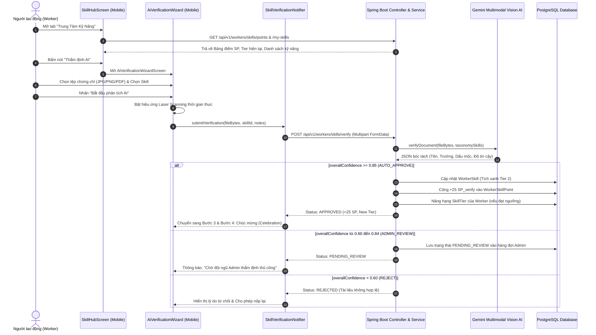

# TÀI LIỆU KỸ THUẬT: LUỒNG THẨM ĐỊNH KỸ NĂNG & THĂNG HẠNG NGHỀ NGHIỆP WORKER (SKILL VERIFICATION)
**Dự án:** CANi - Nền tảng Điều phối Nhân sự Sự kiện  
**Phạm vi:** Ứng dụng Di động Worker (Flutter) & Máy chủ Backend (Spring Boot, Gemini Vision AI, PostgreSQL)  
**Thời gian cập nhật:** Tháng 10/2026  

---

## 📌 MỤC LỤC
1. [Khái niệm Cốt lõi & Quy chế 3 Cấp bậc Kỹ năng (3 Verification Tiers)](#1-khái-niệm-cốt-lõi--quy-chế-3-cấp-bậc-kỹ-năng-3-verification-tiers)
2. [Sơ đồ tuần tự tương tác (Sequence Diagram)](#2-sơ-đồ-tuần-tự-tương-tác-sequence-diagram)
3. [Giai đoạn 1: Khởi động tại Trung Tâm Kỹ Năng (SkillHubScreen)](#3-giai-đoạn-1-khởi-động-tại-trung-tâm-kỹ-năng-skillhubscreen)
4. [Giai đoạn 2: Khai báo Kỹ năng Tier 1 (DeclareSkillsSheet)](#4-giai-đoạn-2-khai-báo-kỹ-năng-tier-1-declareskillssheet)
5. [Giai đoạn 3: Nộp Chứng chỉ Thẩm định Vision AI Tier 2 (AiVerificationWizardScreen)](#5-giai-đoạn-3-nộp-chứng-chỉ-thẩm-định-vision-ai-tier-2-ai-verification-wizard-screen)
6. [Giai đoạn 4: Bóc tách Multimodal Vision AI & Định tuyến tại Backend](#6-giai-đoạn-4-bóc-tách-multimodal-vision-ai--định-tuyến-tại-backend)
7. [Giai đoạn 5: Nhận kết quả, Thăng hạng Tài khoản & Vinh danh (Celebration)](#7-giai-đoạn-5-nhận-kết-quả-thăng-hạng-tài-khoản--vinh-danh-celebration)
8. [Bảng tra cứu nhanh "Nút nào - File nào - Hàm nào"](#8-bảng-tra-cứu-nhanh-nút-nào---file-nào---hàm-nào)

---

## 1. Khái niệm Cốt lõi & Quy chế 3 Cấp bậc Kỹ năng (3 Verification Tiers)

Nền tảng CANi xây dựng cơ chế **Đánh giá Năng lực Đa tầng (Multi-tier Skill Verification)** theo quy chuẩn `BR-16` và `BR-65` nhằm bảo vệ quyền lợi thù lao của Worker và bảo đảm chất lượng nhân sự cho Nhà tổ chức sự kiện (Event Organizer - EO):

```text
┌─────────────────────────────────────────────────────────────────────────────┐
│                       3 CẤP BẬC XÁC THỰC KỸ NĂNG (TIERS)                    │
├─────────────────────────────────────────────────────────────────────────────┤
│ 🥉 Tier 1: TỰ KHAI BÁO (Self-Declared)                                      │
│    • Người dùng tự chọn kỹ năng có sẵn từ Taxonomy của sàn CANi.            │
│    • Trạng thái: Kích hoạt ngay (ACTIVE). SP_verify: 0 điểm.                │
├─────────────────────────────────────────────────────────────────────────────┤
│ 🥈 Tier 2: THẨM ĐỊNH AI VISION (AI Document Verified)                       │
│    • Tải ảnh bằng cấp, chứng chỉ nghề, chứng nhận an toàn, tiếng Anh.       │
│    • Gemini Vision AI quét dấu mộc, chữ ký, độ uy tín và đối soát Taxonomy. │
│    • Quyết định tự động: Phê duyệt -> Cấp tích xanh Tier 2, CỘNG +25 SP.    │
├─────────────────────────────────────────────────────────────────────────────┤
│ 🥇 Tier 3: KIỂM CHỨNG THỰC TẾ TRÊN SÀN (Platform Proven)                   │
│    • Tích lũy qua các ca làm thực tế (Shift Assignments) trên sàn CANi.     │
│    • Đạt tối thiểu 5 ca làm việc xuất sắc với điểm đánh giá EO ≥ 4.5/5.0.   │
└─────────────────────────────────────────────────────────────────────────────┘
```

### Công thức tính Điểm Kỹ Năng & Thăng hạng (Skill Points - SP):
$$\text{Total SP} = \text{SP\_verify} \text{ (Chứng chỉ AI)} + \text{SP\_work} \text{ (Ca làm thực tế)} + \text{SP\_rating} \text{ (Điểm đánh giá EO)}$$

* **Cấp bậc thăng hạng tài khoản (`SkillTier`):**
  * ⚪ **STARTER (0 - 49 SP):** Mới gia nhập, chỉ nhận các ca việc phổ thông.
  * 🟤 **BRONZE (50 - 149 SP):** Đã có chứng chỉ hoặc ca làm cơ bản.
  * ⚪ **SILVER (150 - 299 SP):** Được ưu tiên nhận ca làm việc tiêu chuẩn.
  * 🟡 **GOLD (300 - 499 SP):** Mở khóa ca làm việc VIP, thù lao cao hơn 15 - 25%.
  * 🟣 **PLATINUM (≥ 500 SP):** Nhân sự chủ chốt (Leader, Trưởng nhóm ca trực).

---

## 2. Sơ đồ tuần tự tương tác (Sequence Diagram)



---

## 3. Giai đoạn 1: Khởi động tại Trung Tâm Kỹ Năng (SkillHubScreen)

### 3.1. Điểm xuất phát
* **Mở màn hình:**
  * Từ thanh điều hướng chính: Tab thứ 3 trên màn hình [`HomeScreen`](file:///D:/SEP490/Code/mobile/lib/app/home_screen.dart) (`SkillHubScreen`).
  * Hoặc từ màn hình Tài khoản [`ProfileScreen`](file:///D:/SEP490/Code/mobile/lib/features/profile/screens/profile_screen.dart): Bấm vào thanh dải năng lực `ProfileTrustSkillStrip`.
* **Tệp mã nguồn:** `mobile/lib/features/skill_verification/screens/skill_hub_screen.dart`

### 3.2. Thành phần giao diện cốt lõi
1. **Thẻ Hạng Tối Thượng (`HeroTierCard` - dòng 79):**
   * Hiển thị Cấp bậc hiện tại (ví dụ: `STARTER`, `BRONZE`, `SILVER`, `GOLD`, `PLATINUM`).
   * Thanh tiến trình phần trăm đạt tới cấp bậc kế tiếp (`SkillHubColors.getNextTierThreshold`).
2. **Ba khối thống kê hiệu suất (`SkillStatsRow` - dòng 87):**
   * Tổng điểm SP hiện có.
   * Số lượng kỹ năng đã kích hoạt.
   * Số lượng kỹ năng đã được thẩm định tích xanh.
3. **Thanh hành động nhanh (`QuickActionBar` - dòng 95):**
   * 🔘 Nút **"Thẩm định AI (AI Verification)"**: Khởi chạy Wizard kiểm chứng chứng chỉ.
   * 🔘 Nút **"Khai báo kỹ năng"**: Mở BottomSheet tự khai báo Tier 1.
   * 🔘 Nút **"Kho chứng chỉ"**: Mở BottomSheet xem lịch sử hồ sơ đã nộp.
4. **Ma trận kỹ năng đa tầng (`DynamicSkillMatrix` - dòng 108):**
   * Phân loại trực quan kỹ năng theo 3 Tier (Tự khai báo, Đã duyệt AI, Đã kiểm chứng thực tế).

---

## 4. Giai đoạn 2: Khai báo Kỹ năng Tier 1 (DeclareSkillsSheet)

### 4.1. Thao tác người dùng
* **Nút bấm:** Nút **"Khai báo kỹ năng"** trên thanh QuickActionBar (`QuickActionBar.dart`) hoặc trong ma trận `DynamicSkillMatrix`.
* **Giao diện:** Mở BottomSheet `DeclareSkillsSheet` tải danh mục kỹ năng chuẩn (Taxonomy) từ máy chủ Backend.
* Người dùng tích chọn các kỹ năng sự kiện mình có: Phục vụ bàn (Waiter), Lễ tân (PG/PB), Pha chế (Bartender), Hậu cần âm thanh ánh sáng (Logistics/AV), MC, v.v.
* Bấm nút **"Lưu danh sách kỹ năng"**.

### 4.2. Luồng gọi API & Xử lý Backend
* **Frontend State:** `ref.read(skillVerificationProvider.notifier).declareSkills(selectedSkillIds)`.
* **API Client:** `POST /api/v1/workers/skills/declare`
* **Controller Backend:** `SkillVerificationController.java` (dòng 37)
  ```java
  @PostMapping("/declare")
  public ResponseEntity<ApiResponse<List<WorkerSkillResponseDto>>> declareSkills(
          @Valid @RequestBody DeclareSkillRequestDto request,
          Authentication authentication)
  ```
* **Service Backend:** `SkillVerificationService.java` (dòng 199):
  1. Duyệt danh sách kỹ năng gửi lên, gán vào bảng `public.worker_skills`.
  2. Thiết lập `verification_tier = VerificationTier.SELF_DECLARED`.
  3. Điểm số: `SP_verify = 0` (theo đúng quy chế BR-16: Tự khai báo không được cộng điểm chứng thực).
  4. Trả về thông báo: *"Khai báo kỹ năng thành công (Tier 1: Tự khai báo, 0 SP_verify)"*.

---

## 5. Giai đoạn 3: Nộp Chứng chỉ Thẩm định Vision AI Tier 2 (AiVerificationWizardScreen)

Đây là **tính năng công nghệ trọng tâm (AI Multimodal)** của đồ án CANi.

### 5.1. Khởi chạy Wizard thẩm định
* **Nút bấm:** Nút chính **"Thẩm định AI (AI Verification)"** trên `QuickActionBar` (dòng 96) hoặc nút **"Nâng cấp Tier 2"** trong từng thẻ kỹ năng.
* **Hành vi điều hướng:**
  ```dart
  Navigator.of(context).push(
    MaterialPageRoute(builder: (_) => const AiVerificationWizardScreen()),
  );
  ```
* **Tệp mã nguồn:** `mobile/lib/features/skill_verification/screens/ai_verification_wizard_screen.dart`

### 5.2. Các bước trong Wizard (4 Bước khép kín)
* **Bước 1: Chọn tài liệu chứng chỉ:**
  * Hàm `_pickFile()` (dòng 45) sử dụng thư viện `file_picker`.
  * Hỗ trợ định dạng: `jpg`, `jpeg`, `png`, `pdf` (Dung lượng tối đa 5MB).
  * Cho phép người dùng chọn danh mục kỹ năng muốn đối chiếu hoặc để AI tự động nhận diện từ nội dung văn bằng.
* **Bước 2: Quét Laser AI thời gian thực:**
  * Bấm nút: **"Bắt đầu phân tích AI"** (`_startScanningAndSubmit` dòng 68).
  * Giao diện kích hoạt hiệu ứng hoạt họa Laser Scan (`_scannerAnimController` chạy tia laser xanh lướt dọc bề mặt tài liệu).
  * Trong lúc hiệu ứng chạy, ứng dụng gửi tệp tin nhị phân qua giao thức Multipart FormData tới máy chủ Backend.

---

## 6. Giai đoạn 4: Bóc tách Multimodal Vision AI & Định tuyến tại Backend

### 6.1. Tiếp nhận tại Controller
* **Tệp mã nguồn:** `backend/src/main/java/com/cani/controller/SkillVerificationController.java`
* **Endpoint:** `@PostMapping(value = "/verify", consumes = MediaType.MULTIPART_FORM_DATA_VALUE)` (dòng 64)
* **Tham số nhận vào:**
  * `file`: Tệp MultipartFile chứng chỉ.
  * `skillId`: ID kỹ năng mục tiêu (tùy chọn).
  * `notes`: Ghi chú bổ sung từ Worker.

### 6.2. Phân tích tài liệu bằng Gemini Vision AI
* **Tệp mã nguồn:** `backend/src/main/java/com/cani/client/skill/SkillVisionAiClient.java`
* **Cơ chế hoạt động:**
  1. Gửi ảnh chứng chỉ cùng bảng Taxonomy chuẩn của CANi sang mô hình AI Vision:
  ```json
  {
    "recipientName": "Tên người được cấp bằng",
    "identityNumber": "Số CCCD hoặc mã học viên (nếu có)",
    "institution": "Tổ chức/Trường học/Trung tâm cấp chứng chỉ",
    "issueDate": "Ngày tháng cấp bằng",
    "hasSealOrSignature": true,
    "overallConfidence": 0.92,
    "extractedSkills": [
      {
        "skillName": "Pha chế đồ uống nâng cao",
        "taxonomyRole": "Pha chế (Bartender)"
      }
    ]
  }
  ```

### 6.3. Định tuyến nghiệp vụ & Cập nhật Cơ sở dữ liệu
Tại `SkillVerificationService.java` (hàm `persistVerificationResult` dòng 111):
1. **Trường hợp 1: `overallConfidence >= 0.85` (Tự động Phê duyệt - AUTO_APPROVE):**
   * Cập nhật trạng thái chứng chỉ: `status = APPROVED`.
   * **Cộng điểm kỹ năng (`spAwarded`):** Cộng ngay **+25 SP_verify** cho mỗi kỹ năng được duyệt (Quy chế `BR-65`).
   * Cập nhật bảng `public.worker_skills`: Gán `verification_tier = AI_DOCUMENT` kèm tích xanh bảo chứng.
   * Tính toán lại tổng điểm `Total SP` trong bảng `public.worker_skill_points`.
   * Nếu tổng điểm vượt ngưỡng, tự động thăng hạng tài khoản của Worker (`worker.setSkillTier(calculatedTier)`).
2. **Trường hợp 2: `0.60 <= overallConfidence < 0.85` (ADMIN_REVIEW):**
   * Đưa hồ sơ vào trạng thái `PENDING_REVIEW`.
   * Đẩy vào hàng đợi thẩm định của CSKH/Admin tại giao diện quản trị (`screen_018_verification_details.png`).
3. **Trường hợp 3: `overallConfidence < 0.60` (Từ chối - REJECT):**
   * Đánh dấu `REJECTED`, lưu lý do (tài liệu mờ, không tìm thấy con dấu, hoặc kỹ năng không thuộc ngành sự kiện).

---

## 7. Giai đoạn 5: Nhận kết quả, Thăng hạng Tài khoản & Vinh danh (Celebration)

### 7.1. Phản hồi trả về Mobile
* Backend trả về đối tượng `SkillVerificationResponseDto`:
  * `routingDecision`: `AUTO_APPROVE` / `ADMIN_REVIEW` / `REJECT`
  * `spAwarded`: `25`
  * `currentTier`: Hạng tài khoản mới
  * `extractedSkills`: Danh sách kỹ năng bóc tách thành công.

### 7.2. Giao diện Wizard (Bước 3 & Bước 4)
* **Bước 3 - Hiển thị Kết quả Thẩm định:**
  * Hiển thị bảng chi tiết: Tên chứng chỉ, Tổ chức cấp, Kỹ năng công nhận, Huy hiệu tích xanh Tier 2.
* **Bước 4 - Màn hình Vinh danh (Celebration Screen):**
  * Hiệu ứng pháo hoa chúc mừng thăng hạng.
  * Hiển thị số điểm được cộng: **"+25 SP"**.
  * Nút bấm: **"Quay lại Trung Tâm Kỹ Năng"** hoặc **"Xem ca làm việc phù hợp"**.

---

## 8. Bảng tra cứu nhanh "Nút nào - File nào - Hàm nào"

| STT | Bước thao tác | Nút bấm trên UI | Tệp mã nguồn (File & Dòng) | Hàm xử lý kích hoạt (Mobile) | Endpoint API gọi xuống Backend |
|:---:|:---|:---|:---|:---|:---|
| **1** | Mở Trung Tâm Kỹ Năng | Tab *"Kỹ năng"* hoặc Banner Profile | `mobile/.../home_screen.dart` | `Navigator.push(SkillHubScreen)` | `GET /v1/workers/skills/points`<br>`GET /v1/workers/skills/my-skills` |
| **2** | Mở form Tự khai báo | Nút *"Khai báo kỹ năng"* | `mobile/.../quick_action_bar.dart` (L45) | `DeclareSkillsSheet.show()` | `GET /v1/workers/skills/taxonomy` |
| **3** | Lưu kỹ năng Tier 1 | Nút *"Lưu danh sách kỹ năng"* | `mobile/.../declare_skills_sheet.dart` | `notifier.declareSkills()` | `POST /v1/workers/skills/declare`<br>`SkillVerificationController:37` |
| **4** | Mở Wizard Thẩm định AI | Nút **"Thẩm định AI (AI Verification)"** | `mobile/.../skill_hub_screen.dart` (L96) | `Navigator.push(AiVerificationWizard)` | *(Mở màn hình Wizard nội bộ)* |
| **5** | Chọn tệp chứng chỉ | Khung tải lên *"Chọn ảnh hoặc PDF"* | `mobile/.../ai_verification_wizard.dart` (L45) | `_pickFile()` (FilePicker) | *(Thư viện phần cứng FilePicker)* |
| **6** | Gửi phân tích AI | Nút **"Bắt đầu phân tích AI"** | `mobile/.../ai_verification_wizard.dart` (L68) | `_startScanningAndSubmit()` | `POST /v1/workers/skills/verify`<br>`SkillVerificationController:64` |
| **7** | Thẩm định Vision AI | *(Tự động bên trong Backend)* | `backend/.../SkillVisionAiClient.java` (L40) | `verifyDocument()` | Gọi Gemini Multimodal AI API |
| **8** | Xem kho chứng chỉ | Nút *"Kho chứng chỉ"* | `mobile/.../quick_action_bar.dart` (L55) | `CertificateVaultSheet.show()` | `GET /v1/workers/skills/history`<br>`SkillVerificationController:90` |
| **9** | Admin duyệt thủ công | Nút *"Phê duyệt"* / *"Từ chối"* | `backend/.../SkillVerificationController.java` (L135) | `adminReview()` | `POST /v1/workers/skills/admin/{id}/review` |

---
*Tài liệu được trích xuất và đồng bộ chuẩn xác theo mã nguồn dự án CANi.*
