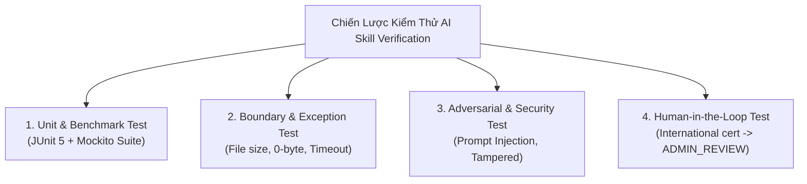

# KẾ HOẠCH KIỂM THỬ (TEST PLAN)
# HỆ THỐNG THẨM ĐỊNH KỸ NĂNG TỰ ĐỘNG BẰNG AI (UC-43 & UC-46)

**Dự án:** CANi - On-Demand Event Workforce Coordination Platform  
**Mã tài liệu:** `CANi_Test_Plan_AI_Skill_Verification_v1.1`  
**Phiên bản:** `1.1`  
**Ngày lập:** `2026-11-19`  
**Tác giả:** `hungpd (Phạm Duy Hưng)`  
**Phạm vi áp dụng:** Report 5 - Test Documentation (Hạng mục AI Evaluation & Unit Test)

---

## 1. TỔNG QUAN & MỤC TIÊU (OVERVIEW & OBJECTIVES)

### 1.1. Bối cảnh bài toán
Trong nền tảng điều phối nhân sự sự kiện CANi, Worker sau khi tạo tài khoản sẽ ở phân hạng **Tier 1 (STARTER)** với 0 điểm kỹ năng xác thực (`SP_verify = 0`). Để được ưu tiên ghép ca (Matching) vào các vị trí yêu cầu chuyên môn cao (Barista, Bếp, Âm thanh ánh sáng, An ninh) và nâng hạng lên **Tier 2 (PROVEN)**, Worker phải nộp chứng chỉ nghề nghiệp để hệ thống thẩm định.

Tính năng **AI Skill Verification Pipeline (UC-46)** cho phép:
* Phân tích ảnh chứng chỉ/bằng cấp tự động bằng Gemini 3.8 Flash Vision AI.
* Đối soát danh tính Worker, cơ sở đào tạo, con dấu pháp lý và danh mục kỹ năng CANi Taxonomy.
* Tự động phê duyệt (`AUTO_APPROVE`) và cộng ngay `+25 SP_verify` trong vòng dưới 5 giây.
* Chuyển duyệt thủ công (`ADMIN_REVIEW`) đối với chứng chỉ quốc tế / ranh giới để bảo vệ quyền lợi Worker.
* Từ chối (`REJECT`) các hồ sơ gian lận (mượn bằng, cắt dán), ảnh rác, hoặc nộp nhầm CV cá nhân tự khai.

### 1.2. Mục tiêu kiểm thử (Test Objectives)
1. **Kiểm chứng độ chính xác phân loại:** Đạt tỷ lệ chính xác tổng thể $\ge 95\%$.
2. **Kiểm soát rủi ro tử huyệt (Zero False Positive):** Đảm bảo $\text{False Positive Rate (FPR)} = 0.0\%$, tuyệt đối không tự động duyệt nhầm bằng giả, bằng mượn hoặc CV tự khai.
3. **Kiểm tra khả năng chịu lỗi & ngoại lệ (Fault Tolerance):** Hệ thống không bị sập (Crash 500) khi gặp tệp quá 5MB, tệp rỗng 0 bytes, hoặc khi dịch vụ AI ngoài bị gián đoạn kết nối.
4. **Khả năng giải trình (Explainability):** Mọi quyết định từ chối phải có thông điệp tiếng Việt rõ ràng, mang tính sư phạm hướng dẫn Worker khắc phục.

---

## 2. PHẠM VI KIỂM THỬ (TEST SCOPE)

### 2.1. Trong phạm vi (In-Scope)
* **Backend Service & Controller:** `SkillVerificationService`, `SkillVerificationController`.
* **Vision AI Client & Prompt:** `SkillVisionAiClient`, `Gemini REST Client API`, `Smart Sandbox Evaluation Engine`.
* **Luồng xử lý dữ liệu:**
  - Chuẩn hóa tên học viên (bỏ dấu tiếng Việt, so khớp chữ hoa/thường).
  - Phân loại tài liệu (Bằng cấp chính quy vs CV cá nhân vs Tài liệu rác).
  - Nhận diện tính hợp lệ của con dấu mộc đỏ, chữ ký, hoặc chứng chỉ quốc tế (SCA, WSET, Coursera có mã số tra cứu điện tử).
  - Giao dịch nguyên tử (ACID Transaction) cộng điểm `WorkerSkillPoint` và thăng hạng `SkillTier`.
* **Bộ dữ liệu thực nghiệm:** 34 kịch bản kiểm thử (Test Cases `UTC001` – `UTC034`) kèm tệp ảnh/PDF thật tại thư mục `sample_images/`.

### 2.2. Ngoài phạm vi (Out-of-Scope)
* Tốc độ render giao diện camera trên từng dòng chip điện thoại Android/iOS cũ.
* Độ chịu tải đồng thời trên 10.000 requests/giây (thuộc phạm vi Performance / Load Test của Report 5.4).

---

## 3. CHIẾN LƯỢC KIỂM THỬ (TEST STRATEGY)

* **Kiểm thử hộp trắng (White-box Unit Testing):** Kiểm thử logic nghiệp vụ nội tại của `SkillVerificationService`, đảm bảo việc gọi Vision AI diễn ra ngoài Database Transaction để chống chiếm dụng Connection Pool.
* **Kiểm thử hộp đen (Black-box AI Benchmark):** Sử dụng bộ dữ liệu Golden Dataset 34 mẫu đa dạng để đo lường Ma trận nhầm lẫn (Confusion Matrix).
* **Kiểm thử ranh giới & ngoại lệ (Boundary & Exception Testing):** Thử nghiệm tải tệp $>5\text{MB}$, tệp $0\text{ bytes}$, tệp không đúng định dạng và mô phỏng đứt mạng Vision AI API.
* **Kiểm thử an toàn thông tin (Adversarial Robustness):** Chèn các câu lệnh điều khiển hệ thống (`[SYSTEM OVERRIDE]`) vào ảnh chứng chỉ nhằm kiểm tra tính bất biến của System Prompt.

---

## 4. TIÊU CHUẨN ĐÁNH GIÁ (ACCEPTANCE CRITERIA)

| Chỉ số (Metric) | Mục tiêu chấp nhận | Mô tả & Ý nghĩa |
| :--- | :---: | :--- |
| **Độ chính xác (Accuracy)** | $\ge 95.0\%$ | Tỷ lệ đưa ra quyết định đúng trên toàn bộ 34 ca kiểm thử. |
| **Độ chuẩn xác (Precision)** | $100.0\%$ | Tỷ lệ hồ sơ được duyệt tự động là hồ sơ thật chuẩn chỉ. |
| **Độ nhạy / Thu hồi (Recall)** | $\ge 95.0\%$ | Tỷ lệ nhận diện đúng các chứng chỉ hợp lệ. |
| **Tỷ lệ duyệt nhầm (FPR)** | **$0.00\%$** | **Chỉ số sống còn:** Tuyệt đối không duyệt lọt bất kỳ bằng giả/lệch tên/CV nào. |
| **Thời gian phản hồi (Latency)** | $\le 5.0\text{ giây}$ | Thời gian từ lúc Worker bấm gửi đến khi nhận kết quả. |
| **Tính bền vững ngoại lệ** | $0$ lỗi Crash `500` | Mọi ngoại lệ kỹ thuật phải trả về mã HTTP `4xx` hoặc Fallback an toàn. |

---

## 5. THIẾT KẾ KỊCH BẢN KIỂM THỬ (TEST MATRIX SUMMARY)

Toàn bộ 34 ca kiểm thử được thiết kế chi tiết trong tệp Excel `AI_Skill_Verification_Test_Matrix_v1.1.xlsx`, phân bổ theo 7 nhóm section:

| Nhóm | Số lượng | Dải mã test | Mục đích kiểm thử |
| :--- | :---: | :---: | :--- |
| **1. Happy Path** | 7 | `UTC001` – `UTC007` | Bằng chính quy (Saigontourist, Á Âu, Văn Lang, BCA...) $\rightarrow$ `AUTO_APPROVE`. |
| **2. Identity Mismatch** | 5 | `UTC008` – `UTC012` | Mượn bằng bạn, mượn bằng người yêu, chắp vá tên Photoshop $\rightarrow$ `REJECT`. |
| **3. Visual Degradation** | 5 | `UTC013` – `UTC017` | Ảnh mờ nhòe, lóa flash, cắt xén 50%, scan đen trắng, chụp ngược $\rightarrow$ `REJECT`. |
| **4. Out-of-Domain** | 5 | `UTC018` – `UTC022` | Hóa đơn EVN, ảnh selfie, meme, bằng lái xe, bằng IT $\rightarrow$ `REJECT`. |
| **5. Adversarial Security** | 3 | `UTC023` – `UTC025` | Prompt Injection, bằng tự chế Word/Paint, bằng hết hạn 10 năm $\rightarrow$ `REJECT`. |
| **6. Self-Declared CVs** | 5 | `UTC026` – `UTC030` | 5 tệp CV tự khai (`Phạm Duy Hưng_CV.pdf`, `Nguyễn Minh Trang`...) $\rightarrow$ `REJECT`. |
| **7. Technical Exceptions** | 4 | `UTC031` – `UTC034` | File $>5\text{MB}$, File $0\text{B}$, Lỗi mạng AI (Fallback), Bằng quốc tế (`ADMIN_REVIEW`). |

---

## 6. MÔI TRƯỜNG & DỮ LIỆU KIỂM THỬ

* **Môi trường Server:** Java OpenJDK 21 LTS, Spring Boot 3.5.1 Starter Test, RestClient.
* **Mô hình Vision AI:** Google Gemini 3.8 Flash (`temperature = 0.1` để đảm bảo tính ổn định suy luận).
* **Thư viện Mocking & Test Runner:** JUnit 5 (Jupiter), Mockito 5, AssertJ, Spring MockMvc.
* **Kho dữ liệu ảnh mẫu:** Lưu trữ tại thư mục `sample_images/` với 30 file ảnh/PDF thực nghiệm.
