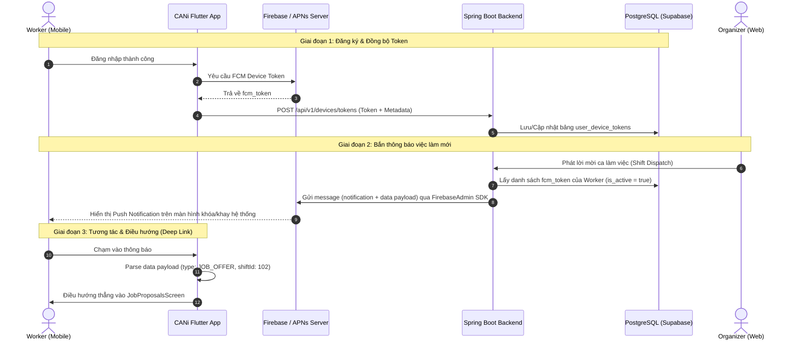
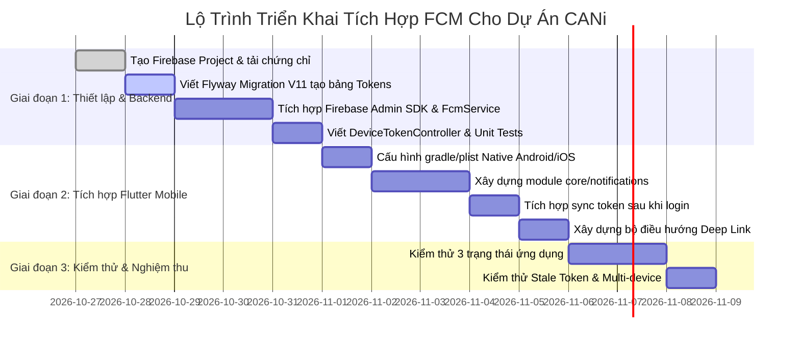

# CANi Platform - Kế Hoạch Thiết Kế & Tích Hợp Firebase Cloud Messaging (FCM)

> **Tài liệu:** Bản thiết kế kiến trúc kỹ thuật & Kế hoạch triển khai Push Notification (FCM)  
> **Phiên bản:** 1.0.0  
> **Áp dụng cho:** `backend/` (Spring Boot 3.5.1, Java 21) & `mobile/` (Flutter 3.x, Riverpod)  
> **Tiêu chuẩn tuân thủ:** Clean Architecture, YAGNI & KISS, Zero AI-Bloat

---

## 1. Bối Cảnh Nghiệp Vụ & Phân Tích Đánh Đổi (Trade-offs)

### 1.1. Tại sao CANi bắt buộc cần Push Notification?
Nền tảng **CANi (Event Staffing Platform)** có đặc thù vận hành theo thời gian thực (Real-time On-demand Matching):
1. **Điều phối ca làm việc khẩn cấp (Emergency Dispatch):** Khi một Nhà tổ chức sự kiện (Event Organizer) thiếu nhân sự đột xuất, hệ thống quét các Worker đang bật chế độ *Job Radar* trong bán kính 5–15km. Lời mời việc phải đánh thức thiết bị của Worker ngay lập tức.
2. **Nhắc nhở ca làm (Shift Reminders):** Tự động gửi thông báo trước giờ vào ca (T-2h, T-30m) để giảm tỷ lệ bỏ ca (*No-show rate*).
3. **Cập nhật trạng thái thẩm định (Skill/eKYC Audits):** Thông báo khi AI Vision hoàn tất duyệt chứng chỉ hoặc Admin phê duyệt hồ sơ.
4. **Xác nhận chấm công (Attendance & Settlement):** Thông báo tức thời khi quét mã QR check-in/check-out thành công hoặc tiền công được cộng vào ví.

### 1.2. Đánh đổi kỹ thuật: Tại sao chọn FCM thay vì Polling hay WebSocket?

```
┌──────────────────────┬──────────────────────┬────────────────────────────────────────────────────────┐
│ Giải pháp            │ Ưu điểm              │ Hạn chế & Lý do loại trừ                               │
├──────────────────────┼──────────────────────┼────────────────────────────────────────────────────────┤
│ HTTP Polling         │ Đơn giản, dễ code    │ Tốn pin, tốn băng thông, trễ cao, vô dụng khi app bị   │
│                      │                      │ kill/terminated bởi hệ điều hành.                     │
├──────────────────────┼──────────────────────┼────────────────────────────────────────────────────────┤
│ WebSocket / SSE      │ Realtime cực cao     │ Chỉ duy trì được khi app ở Foreground. Khi app bị OS   │
│ (Supabase Realtime)  │ khi app đang mở      │ suspend/kill (chạy nền), socket bị đứt kết nối.        │
├──────────────────────┼──────────────────────┼────────────────────────────────────────────────────────┤
│ Firebase Cloud       │ Tiêu chuẩn của OS    │ Phụ thuộc vào Google Play Services / APNs; cần quản lý │
│ Messaging (FCM)      │ (Android & iOS),     │ vòng đời device token (Token Lifecycle Management).    │
│                      │ tiết kiệm pin, đánh  │                                                        │
│                      │ thức được app nền.   │                                                        │
└──────────────────────┴──────────────────────┴────────────────────────────────────────────────────────┘
```
**Kết luận kiến trúc:** Kết hợp **FCM** cho thông báo cấp hệ điều hành (khi app chạy nền hoặc bị tắt) và **Riverpod/In-app State** để cập nhật UI mượt mà khi app đang mở ở tiền cảnh (Foreground).

---

## 2. Kiến Trúc Tổng Thể & Luồng Dữ Liệu (End-to-End Flow)

### 2.1. Sơ đồ tương tác các thành phần



---

## 3. Thiết Kế Cơ Sở Dữ Liệu (Flyway Migration)

Để hỗ trợ một người dùng đăng nhập nhiều thiết bị (*Multi-device login*), tự động thu hồi khi đăng xuất và loại bỏ token rác, hệ thống thiết kế bảng riêng biệt `user_device_tokens`.

### 3.1. Kịch bản Flyway: `V11__create_user_device_tokens.sql`
Vị trí: `backend/src/main/resources/db/migration/V11__create_user_device_tokens.sql`

```sql
-- Migration V11: Tạo bảng quản lý FCM Device Tokens cho đa thiết bị
CREATE TABLE IF NOT EXISTS public.user_device_tokens (
    id UUID PRIMARY KEY DEFAULT gen_random_uuid(),
    user_id UUID NOT NULL REFERENCES public.users(id) ON DELETE CASCADE,
    fcm_token VARCHAR(512) NOT NULL UNIQUE,
    device_type VARCHAR(20) NOT NULL, -- 'ANDROID', 'IOS', 'WEB'
    device_name VARCHAR(100),         -- vd: 'Samsung Galaxy S23', 'iPhone 15'
    app_version VARCHAR(30),          -- vd: '1.0.0+1'
    is_active BOOLEAN NOT NULL DEFAULT true,
    last_active_at TIMESTAMPTZ NOT NULL DEFAULT CURRENT_TIMESTAMP,
    created_at TIMESTAMPTZ NOT NULL DEFAULT CURRENT_TIMESTAMP,
    updated_at TIMESTAMPTZ NOT NULL DEFAULT CURRENT_TIMESTAMP
);

-- Chỉ mục tối ưu truy vấn gửi notification theo user
CREATE INDEX idx_user_device_tokens_user_id ON public.user_device_tokens(user_id) WHERE is_active = true;
CREATE INDEX idx_user_device_tokens_fcm_token ON public.user_device_tokens(fcm_token);
```

### 3.2. Chiến lược xử lý các trường hợp biên (Edge Cases)
1. **User đổi máy hoặc cài lại app:** FCM cấp token mới $\rightarrow$ Mobile gửi API cập nhật $\rightarrow$ Backend cập nhật bản ghi mới, đánh dấu bản ghi cũ `is_active = false`.
2. **User Đăng xuất (Logout):** Mobile bắt buộc gọi `DELETE /api/v1/devices/tokens/{token}` để xóa hoặc tắt `is_active`, ngăn chặn rò rỉ thông báo của tài khoản cũ sang người dùng mới trên cùng thiết bị.
3. **Stale Tokens (Token bị Firebase khai tử):** Khi app bị xóa, Firebase gửi mã lỗi `UNREGISTERED` hoặc `INVALID_ARGUMENT`. Backend bắt mã lỗi này và tự động xóa mềm (`is_active = false`) ngay trong luồng xử lý.

---

## 4. Thiết Kế Phía Backend (Spring Boot 3.5.1)

### 4.1. Thư viện phụ thuộc (`backend/pom.xml`)
Bổ sung **Google Firebase Admin SDK**:

```xml
<dependency>
    <groupId>com.google.firebase</groupId>
    <artifactId>firebase-admin</artifactId>
    <version>9.4.1</version>
</dependency>
```

### 4.2. Cấu hình Firebase (`FirebaseConfig.java` & `application.yml`)
> [!IMPORTANT]
> **Nguyên tắc bảo mật:** Tuyệt đối không commit tệp JSON chứa Private Key của Firebase Service Account vào Git repository. Nạp cấu hình thông qua biến môi trường dạng Base64 hoặc đường dẫn tệp ngoài thư mục dự án.

**Cấu hình trong `backend/src/main/resources/application.yml`:**
```yaml
cani:
  firebase:
    enabled: ${FIREBASE_ENABLED:true}
    service-account-base64: ${FIREBASE_SERVICE_ACCOUNT_BASE64:}
    service-account-path: ${FIREBASE_SERVICE_ACCOUNT_PATH:firebase-service-account.json}
```

**Lớp khởi tạo `FirebaseConfig.java`:**
*   Vị trí: `backend/src/main/java/com/cani/config/FirebaseConfig.java`
*   Đảm nhận: Khởi tạo Bean `FirebaseApp` duy nhất dưới dạng Singleton. Nếu chưa cấu hình tệp chứng chỉ, chuyển sang chế độ Mock/Disabled để không làm gián đoạn quá trình khởi động Backend khi phát triển cục bộ (*Local Dev Profile*).

### 4.3. Data Transfer Objects (DTO)
1. `DeviceTokenRegistrationDto`:
   ```java
   public record DeviceTokenRegistrationDto(
       @NotBlank String fcmToken,
       @NotBlank String deviceType, // ANDROID, IOS
       String deviceName,
       String appVersion
   ) {}
   ```
2. `PushNotificationMessage`:
   ```java
   public record PushNotificationMessage(
       UUID targetUserId,
       String title,
       String body,
       NotificationType type, // JOB_OFFER, SHIFT_REMINDER, VERIFICATION_RESULT, ATTENDANCE
       Map<String, String> dataPayload
   ) {}
   ```

### 4.4. Dịch vụ xử lý gửi thông báo (`FcmService.java`)
*   Vị trí: `backend/src/main/java/com/cani/service/notification/FcmService.java`
*   **Nguyên tắc gửi chuẩn:** Luôn đóng gói cả hai khối trong payload:
    *   Khối `notification`: Chứa `title` và `body` để hệ điều hành hiển thị native notification.
    *   Khối `data`: Chứa `type`, `targetId`, `actionUrl` phục vụ việc parse và điều hướng màn hình trên Mobile.
*   **Xử lý Batch Send & Tự làm sạch Token rác:**
    ```java
    BatchResponse response = FirebaseMessaging.getInstance().sendEachForMulticast(multicastMessage);
    for (int i = 0; i < response.getResponses().size(); i++) {
        SendResponse sendResponse = response.getResponses().get(i);
        if (!sendResponse.isSuccessful()) {
            FirebaseMessagingException exception = sendResponse.getException();
            if (exception.getMessagingErrorCode() == MessagingErrorCode.UNREGISTERED) {
                // Token không còn hợp lệ -> đánh dấu vô hiệu hóa trong DB
                deviceTokenRepository.deactivateToken(tokens.get(i));
            }
        }
    }
    ```

### 4.5. REST API Controller (`DeviceTokenController.java`)
*   `POST /api/v1/devices/tokens`: Đăng ký hoặc làm mới token (Yêu cầu JWT Bearer Token của người dùng).
*   `DELETE /api/v1/devices/tokens`: Hủy kích hoạt token khi đăng xuất.

---

## 5. Thiết Kế Phía Mobile (Flutter 3.x)

Tuân thủ nghiêm ngặt chuẩn kiến trúc **Feature-Driven Architecture** và hướng dẫn tại [`mobile-design`](file:///e:/Project%20Workspace/G16_CANi/.agents/skills/mobile-design/SKILL.md).

### 5.1. Thư viện phụ thuộc (`mobile/pubspec.yaml`)
Thêm các package chính thức từ Firebase:
```yaml
dependencies:
  firebase_core: ^3.12.0
  firebase_messaging: ^15.2.0
  flutter_local_notifications: ^18.0.1 # Hiển thị heads-up banner khi app đang ở Foreground
```

### 5.2. Cấu hình Native Android & iOS

#### A. Phía Android
1. **Google Services Plugin:**
   * Thêm vào `mobile/android/settings.gradle.kts`:
     ```kotlin
     plugins {
         id("com.google.gms.google-services") version "4.4.2" apply false
     }
     ```
   * Thêm vào `mobile/android/app/build.gradle.kts`:
     ```kotlin
     plugins {
         id("com.android.application")
         id("dev.flutter.flutter-gradle-plugin")
         id("com.google.gms.google-services")
     }
     ```
2. **Đặt tệp cấu hình:** Đặt `google-services.json` (tải từ Firebase Console) vào thư mục `mobile/android/app/`.
3. **Kênh thông báo (Notification Channel) cho Android 8.0+:** Khởi tạo `AndroidNotificationChannel` với mức ưu tiên cao (`Importance.max`) để cho phép rung và hiện banner nổi.

#### B. Phía iOS
1. Đặt `GoogleService-Info.plist` vào thư mục `mobile/ios/Runner/`.
2. Bật tính năng **Push Notifications** và **Background Modes (Remote notifications)** trong Xcode Capabilities.
3. Upload APNs Authentication Key (`.p8`) lên Firebase Console.

### 5.3. Cấu trúc thư mục mã nguồn Mobile
```text
lib/
├── core/
│   └── notifications/
│       ├── fcm_service.dart              # Khởi tạo Firebase, xin quyền, lắng nghe Token
│       ├── local_notification_service.dart # Quản lý hiển thị Banner khi Foreground
│       └── notification_dispatcher.dart  # Điều hướng màn hình dựa trên payload
└── features/
    └── notifications/                    # Feature quản lý token & danh sách thông báo
        ├── data/
        │   ├── device_token_api.dart     # Gọi API đồng bộ token lên Spring Boot
        │   └── device_token_repository.dart
        ├── models/
        │   └── device_token_dto.dart
        └── providers/
            └── device_token_provider.dart
```

---

## 6. Chiến Lược Xử Lý 3 Trạng Thái Của Ứng Dụng Mobile

Đây là khu vực phát sinh nhiều lỗi nhất nếu không thiết kế đúng theo vòng đời ứng dụng:

```
┌────────────────────────────────────────────────────────────────────────────────────────┐
│                                TRẠNG THÁI ỨNG DỤNG                                     │
├──────────────────────────┬──────────────────────────┬──────────────────────────────────┤
│ 1. FOREGROUND            │ 2. BACKGROUND            │ 3. TERMINATED                    │
│ (Người dùng đang mở app) │ (App thu nhỏ dưới thanh) │ (App bị vuốt tắt hoàn toàn)      │
├──────────────────────────┼──────────────────────────┼──────────────────────────────────┤
│ OS không tự hiện banner. │ FCM SDK tự động đẩy      │ FCM SDK tự động đẩy thông báo    │
│ Lắng nghe qua:           │ thông báo lên khay OS.   │ lên khay hệ thống.               │
│ FirebaseMessaging        │                          │                                  │
│   .onMessage             │ Lắng nghe khi bấm vào:   │ Lắng nghe khi bấm vào mở app:    │
│                          │ FirebaseMessaging        │ FirebaseMessaging.instance       │
│ Dùng local_notifications │   .onMessageOpenedApp    │   .getInitialMessage()           │
│ để bật Heads-up Banner.  │                          │                                  │
└──────────────────────────┴──────────────────────────┴──────────────────────────────────┘
```

### 6.1. Chi tiết điều hướng Deep Linking (`notification_dispatcher.dart`)
Mọi thông báo đều mang `data` map có cấu trúc chuẩn:
```json
{
  "type": "JOB_OFFER",
  "proposalId": "f7d3c0e1-...",
  "targetRoute": "/job-proposals"
}
```
* **Kịch bản 1:** Khi app ở trạng thái **Terminated**, hàm `main()` gọi:
  ```dart
  RemoteMessage? initialMessage = await FirebaseMessaging.instance.getInitialMessage();
  if (initialMessage != null) {
      NotificationDispatcher.handle(initialMessage.data);
  }
  ```
* **Kịch bản 2:** Khi app ở trạng thái **Background**, lắng nghe Stream:
  ```dart
  FirebaseMessaging.onMessageOpenedApp.listen((RemoteMessage message) {
      NotificationDispatcher.handle(message.data);
  });
  ```
* **Kịch bản 3:** Khi app ở trạng thái **Foreground**, `local_notifications` hiển thị popup. Khi user bấm vào banner:
  ```dart
  onDidReceiveNotificationResponse: (response) {
      NotificationDispatcher.handleJson(response.payload);
  }
  ```

---

## 7. Kế Hoạch Triển Khai Chi Tiết (Phased Roadmap)



### 7.1. Bảng Tiêu Chí Nghiệm Thu (Acceptance Criteria & Test Matrix)
- [ ] **AC-1 (Đăng ký Token):** Ngay sau khi Worker đăng nhập, token FCM được sinh ra và gửi thành công lên Backend với mã HTTP 200/201.
- [ ] **AC-2 (Thông báo Nền - Background):** Khóa màn hình thiết bị $\rightarrow$ Bắn API từ Backend $\rightarrow$ Thiết bị rung và hiện thông báo trên khay hệ thống trong vòng dưới 3 giây.
- [ ] **AC-3 (Thông báo Tiền cảnh - Foreground):** Đang mở ứng dụng $\rightarrow$ Bắn API $\rightarrow$ Banner nổi hiển thị trên đầu màn hình không làm gián đoạn tác vụ hiện tại.
- [ ] **AC-4 (Điều hướng chính xác):** Chạm vào thông báo "Lời mời làm việc mới" sẽ mở ứng dụng và dẫn thẳng đến màn hình `JobProposalsScreen`.
- [ ] **AC-5 (Bảo mật Đăng xuất):** Sau khi bấm "Đăng xuất", Backend vô hiệu hóa token; bắn thông báo thử nghiệm sẽ không còn hiển thị trên thiết bị.
- [ ] **AC-6 (Dọn rác tự động):** Khi xóa app khỏi máy và bắn thông báo, Backend bắt lỗi `UNREGISTERED` và tự động cập nhật `is_active = false` trong cơ sở dữ liệu.

---

## 8. Kết Luận & Khuyến Nghị Của Giảng Viên

1. **Tuân thủ nguyên tắc Single Responsibility (SRP):** Module `notifications` chỉ làm đúng nhiệm vụ vận chuyển tin nhắn và định tuyến. Tuyệt đối không nhúng logic xử lý nghiệp vụ ca làm việc vào trong `fcm_service.dart`.
2. **Không làm lộ Private Key:** Chỉ lưu trữ file service account JSON trong môi trường bảo mật (CI/CD Secret hoặc Server Environment).
3. **Đảm bảo khả năng kiểm thử (Testability):** Tại Backend, luôn bọc `FirebaseMessaging` qua một interface `NotificationSender` để khi chạy Unit Test hoặc Integration Test cục bộ, hệ thống có thể mock dễ dàng mà không phụ thuộc vào kết nối mạng tới Google.
